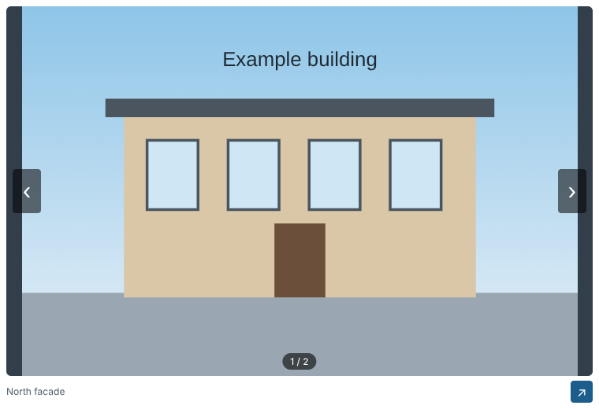

# image_plus

English first, version française plus bas.

## English

image_plus is a custom widget for [Grist](https://www.getgrist.com). It shows the images of the selected row one at a time and opens 360 degree panoramas in a panoramic view. The images come from Grist attachments or from links to a shared drive (Nextcloud, Google Drive, kDrive). The widget can also move the display to a floating window, for a second screen.

### Install

1. Publish the repository with GitHub Pages: Settings, Pages, Source "Deploy from a branch", branch `main`, folder `/ (root)`.
2. The widget address is `https://YOUR-ACCOUNT.github.io/image_plus/index.html`.
3. In Grist, add a page with a custom widget (Add, "Add Page", view type "Custom") and paste that address.
4. In the right-hand panel, choose the access level and the columns (see below).

If your Grist server is not `grist.numerique.gouv.fr`, edit three places in `index.html`: the `src` of the `grist-plugin-api.js` script and, in the Content-Security-Policy line just above it, the host of `script-src` and the host pattern of `connect-src` (for the public service use `https://docs.getgrist.com` and `https://*.getgrist.com`).

### Access level

The widget asks for "Read table". Attachments can only be read with "Full document access", because Grist gives its download token only to widgets that have it: without it the widget says so. Links work with "Read table".

### Columns

In the right-hand panel of Grist, choose the columns. All three are optional, but the widget needs at least the attachments or the links.

| Column | Type | Role |
| --- | --- | --- |
| Attachments | Attachments | The images attached to the row. |
| Links (one per line) | Text | One https link to an image per line. |
| Names (one per line) | Text | One name per line, shown under the picture. The first lines name the attachments, the following lines name the links. A blank line keeps the default name ("Image N"). Add `[360]` to the name of a 360 degree panorama, for example `Hall [360]`: the marker is not shown in the caption. Without the names column no image is a panorama. |

A cell may hold several images. Accepted images: PNG, JPEG, GIF, BMP, WebP, SVG and AVIF. Other formats (PDF, DXF, TIFF, HEIC, RAW...) are reported in a banner that names the column and gives examples. At most 200 images per cell are used.

### Links to a drive

- Nextcloud: paste the share link.
- Google Drive: paste the share link of the file, shared with "Anyone with the link".
- kDrive: paste the address shown in the browser when the picture is open in the share (it ends with `/preview/image/NUMBER`): it holds the file number that the widget needs.
- OneDrive: links cannot be shown in another page. The widget says so and offers to open the link in a new tab.

The commercial drives do not document these addresses: they may stop working one day.

### Using the widget

Previous and next arrows appear on the picture when the pointer is over it (always visible on a touch screen). The left and right arrow keys do the same. In a panorama, drag to look around and use the mouse wheel or the + and - buttons to zoom. A picture larger than the graphics card accepts is reduced automatically and the widget says so. A file larger than 100 MB is not downloaded.

### Floating window (second screen)

The small arrow button at the end of the caption line under the picture opens the images in a floating window that you can drag to another screen. Only one display is active at a time: while the window is open, the widget shows a message and a button "Back to the widget". The window has its own previous and next buttons and arrow keys, and it follows the row selected in Grist. Closing the window, or the button, brings the display back into the widget. If nothing opens, allow pop-ups for your Grist site in the browser.

### Settings: proxy for 360 degree links (optional)

A panoramic view needs the picture to be readable by the page, and most drives forbid that for a link. The widget can send such links through a proxy that you operate (for example a small Cloudflare Worker that adds the missing header and accepts only your own drive domain). The setting is off by default.

In the right-hand panel of Grist, click "Open configuration", tick "Use a proxy for 360° links" and type an https address that contains `{url}`, for example `https://my-proxy.example/?url={url}`. The address is stored in the options of the widget, never in the code. Only the links marked `[360]` go through the proxy: attachments and flat images never do. The proxy receives the address of each 360 degree link, so only name a proxy you trust. Put no token or password in the proxy address: the options of a widget can be read by anyone who has access to the document.

### Dependencies and external services

| Item | Why | Data sent |
| --- | --- | --- |
| `grist-plugin-api.js`, loaded from your Grist server | The Grist widget API | None of your own |
| Pannellum 2.5.6 (MIT licence), copied in `vendor/pannellum/` | The panoramic view | None: loaded from this site |
| Your Grist server | Download of an attachment, only to give it to the panoramic view or to the floating window | The token that Grist gives to the widget |
| The drives named in your cells | Display of the pictures: the browser loads the address of each picture | The usual request of a browser (no referrer is sent) |
| The proxy typed in the settings (optional, off by default) | Panoramic view of a 360 degree link | The address of the 360 degree link |

There is no analytics, no tracking and no font or script from a CDN. The widget stores nothing in the browser. The only value it writes in Grist is the proxy setting, in the options of the widget.

### Security

- The page has a Content-Security-Policy: scripts come from this site and from the Grist plugin API only. `connect-src` accepts `https:` and `blob:` because the Grist server and the proxy are not known in advance; the code fetches nothing else.
- No `eval`, no `new Function`, no inline script. Names and links are inserted into the page as text, never as HTML.
- Links must be absolute https addresses without embedded credentials. A link opened in a new tab carries `rel="noopener noreferrer"`.
- The floating window is a page of this site. Every message between it and the widget is checked for origin and sender, and what the window receives is checked and bounded.
- Pannellum is checked for the same points: see `vendor/pannellum/VENDOR.md`.

### Limits

- 360 degree view needs WebGL.
- Attachments need the access level "Full document access".
- The floating window can be blocked by the pop-up blocker of the browser.
- Drive addresses may change (see above).

### Development and tests

- `npm test` runs the unit tests with Node (no dependency to install): cell analysis, drive links, items handed to the floating window, panorama sizes and proxy setting.
- `npm run test:integration` runs the integration tests in a real browser with a fake Grist object. Run `npm install` once (it installs Playwright, a development tool that the widget never loads). If no browser is installed, run `npx playwright install chromium`, or set `CHROMIUM_PATH` to an existing Chromium.
- Pages reference their scripts with `?v=X.Y.Z`: change that number in `index.html` and `float.html` with every release, so that browsers fetch the new files at once.
- To try the widget locally, serve the folder (`python3 -m http.server 8000`) and paste `http://localhost:8000/index.html` in a custom widget, then put the published address back.

### Files

| File | Role |
| --- | --- |
| `index.html`, `widget.css` | The widget page and its style (shared with the floating window). |
| `widget.js` | Entry point: Grist, the row, what to show and where. |
| `display.js` | Draws one image (flat or panoramic). Used by the widget and the floating window. |
| `float-control.js`, `float.html`, `float.js` | The floating window: control from the widget, page of the window. |
| `settings.js` | The settings form. |
| `images.js`, `drives.js`, `item.js`, `panorama.js`, `proxy.js` | Pure logic, tested with Node. |
| `shared/i18n.js` | French and English texts, picked from the browser language. |
| `vendor/pannellum/` | The panoramic viewer, with its licence. |
| `tests/` | Unit tests; `tests/integration/` holds the browser tests. |

### Licence

MIT, see `LICENSE`. Author: Olivier Holweck.

## Français

image_plus est un widget personnalisé pour [Grist](https://www.getgrist.com). Il affiche une à une les images de la ligne sélectionnée et ouvre les panoramas à 360° dans une vue panoramique. Les images viennent des pièces jointes de Grist ou de liens vers un drive partagé (Nextcloud, Google Drive, kDrive). Le widget peut aussi déplacer l'affichage dans une fenêtre flottante, pour un deuxième écran.

### Installation

1. Publiez le dépôt avec GitHub Pages : Settings, Pages, Source « Deploy from a branch », branche `main`, dossier `/ (root)`.
2. L'adresse du widget est `https://VOTRE-COMPTE.github.io/image_plus/index.html`.
3. Dans Grist, ajoutez une page avec un widget personnalisé (Ajouter, « Ajouter une page », type de vue « Personnalisée ») et collez cette adresse.
4. Dans le panneau de droite, choisissez le niveau d'accès et les colonnes (voir ci-dessous).

Si votre serveur Grist n'est pas `grist.numerique.gouv.fr`, modifiez trois endroits dans `index.html` : l'adresse du script `grist-plugin-api.js` et, dans la ligne Content-Security-Policy située juste au-dessus, l'hôte de `script-src` et le motif d'hôte de `connect-src` (pour le service public, utilisez `https://docs.getgrist.com` et `https://*.getgrist.com`).

### Niveau d'accès

Le widget demande « Lire la table ». Les pièces jointes ne peuvent être lues qu'avec « Accès complet au document », car Grist ne donne son jeton de téléchargement qu'aux widgets qui l'ont : sans lui, le widget l'indique. Les liens fonctionnent avec « Lire la table ».

### Colonnes

Dans le panneau de droite de Grist, choisissez les colonnes. Les trois sont facultatives, mais il faut au moins la colonne des pièces jointes ou celle des liens.

| Colonne | Type | Rôle |
| --- | --- | --- |
| Pièces jointes | Pièces jointes | Les images attachées à la ligne. |
| Liens (un par ligne) | Texte | Un lien https vers une image par ligne. |
| Noms (un par ligne) | Texte | Un nom par ligne, affiché sous l'image. Les premières lignes nomment les pièces jointes, les suivantes nomment les liens. Une ligne vide garde le nom par défaut (« Image N »). Ajoutez `[360]` au nom d'un panorama à 360°, par exemple `Hall [360]` : le repère n'apparaît pas dans la légende. Sans la colonne des noms, aucune image n'est un panorama. |

Une cellule peut contenir plusieurs images. Images acceptées : PNG, JPEG, GIF, BMP, WebP, SVG et AVIF. Les autres formats (PDF, DXF, TIFF, HEIC, RAW...) sont signalés dans un bandeau qui nomme la colonne et donne des exemples. Au plus 200 images par cellule sont prises en compte.

### Liens vers un drive

- Nextcloud : collez le lien de partage.
- Google Drive : collez le lien de partage du fichier, partagé avec « Tous les utilisateurs disposant du lien ».
- kDrive : collez l'adresse affichée par le navigateur quand l'image est ouverte dans le partage (elle se termine par `/preview/image/NUMERO`) : elle contient le numéro de fichier dont le widget a besoin.
- OneDrive : les liens ne peuvent pas être affichés dans une autre page. Le widget l'indique et propose d'ouvrir le lien dans un nouvel onglet.

Les drives commerciaux ne documentent pas ces adresses : elles peuvent cesser de fonctionner un jour.

### Utilisation

Des flèches précédent et suivant apparaissent sur l'image au survol (toujours visibles sur un écran tactile). Les flèches gauche et droite du clavier font la même chose. Dans un panorama, glissez pour regarder autour et utilisez la molette ou les boutons + et - pour zoomer. Une image plus grande que ce que la carte graphique accepte est réduite automatiquement et le widget l'indique. Un fichier de plus de 100 Mo n'est pas téléchargé.

### Fenêtre flottante (deuxième écran)

Le petit bouton fléché au bout de la ligne de légende sous l'image ouvre les images dans une fenêtre flottante que vous pouvez glisser vers un autre écran. Une seule vue est active à la fois : tant que la fenêtre est ouverte, le widget affiche un message et un bouton « Revenir dans le widget ». La fenêtre a ses propres boutons précédent et suivant et ses flèches du clavier, et elle suit la ligne sélectionnée dans Grist. Fermer la fenêtre, ou le bouton, ramène l'affichage dans le widget. Si rien ne s'ouvre, autorisez les fenêtres surgissantes pour votre site Grist dans le navigateur.

### Configuration : proxy pour les liens 360° (facultatif)

Une vue panoramique demande que la page puisse lire l'image, ce que la plupart des drives interdisent pour un lien. Le widget peut faire passer ces liens par un proxy que vous gérez (par exemple un petit Worker Cloudflare qui ajoute l'en-tête manquant et n'accepte que le domaine de votre drive). Le réglage est désactivé par défaut.

Dans le panneau de droite de Grist, cliquez sur « Ouvrir la configuration », cochez « Utiliser un proxy pour les liens 360° » et saisissez une adresse https qui contient `{url}`, par exemple `https://mon-proxy.exemple/?url={url}`. L'adresse est enregistrée dans les options du widget, jamais dans le code. Seuls les liens marqués `[360]` passent par le proxy : les pièces jointes et les images plates n'y passent jamais. Le proxy reçoit l'adresse de chaque lien 360°, n'indiquez donc qu'un proxy de confiance. Ne mettez aucun jeton ni mot de passe dans l'adresse du proxy : les options d'un widget peuvent être lues par toute personne qui a accès au document.

### Dépendances et services externes

| Élément | Raison | Données envoyées |
| --- | --- | --- |
| `grist-plugin-api.js`, chargé depuis votre serveur Grist | L'API des widgets Grist | Aucune qui vous soit propre |
| Pannellum 2.5.6 (licence MIT), copié dans `vendor/pannellum/` | La vue panoramique | Aucune : chargé depuis ce site |
| Votre serveur Grist | Téléchargement d'une pièce jointe, seulement pour la donner à la vue panoramique ou à la fenêtre flottante | Le jeton que Grist donne au widget |
| Les drives cités dans vos cellules | Affichage des images : le navigateur charge l'adresse de chaque image | La requête habituelle d'un navigateur (aucune provenance n'est envoyée) |
| Le proxy saisi dans la configuration (facultatif, désactivé par défaut) | Vue panoramique d'un lien 360° | L'adresse du lien 360° |

Il n'y a ni statistiques ni suivi, ni police ni script venant d'un CDN. Le widget ne stocke rien dans le navigateur. La seule valeur qu'il écrit dans Grist est le réglage du proxy, dans les options du widget.

### Sécurité

- La page a une politique de sécurité du contenu : les scripts viennent de ce site et de l'API des widgets Grist uniquement. `connect-src` accepte `https:` et `blob:` parce que le serveur Grist et le proxy ne sont pas connus à l'avance ; le code ne télécharge rien d'autre.
- Ni `eval`, ni `new Function`, ni script en ligne. Les noms et les liens sont insérés dans la page comme du texte, jamais comme du HTML.
- Les liens doivent être des adresses https absolues sans identifiants. Un lien ouvert dans un nouvel onglet porte `rel="noopener noreferrer"`.
- La fenêtre flottante est une page de ce site. Chaque message entre elle et le widget est vérifié (origine et émetteur), et ce que la fenêtre reçoit est vérifié et borné.
- Pannellum est vérifié sur les mêmes points : voir `vendor/pannellum/VENDOR.md`.

### Limites

- La vue à 360° demande WebGL.
- Les pièces jointes demandent le niveau d'accès « Accès complet au document ».
- La fenêtre flottante peut être bloquée par le bloqueur de fenêtres surgissantes du navigateur.
- Les adresses des drives peuvent changer (voir plus haut).

### Développement et tests

- `npm test` lance les tests unitaires avec Node (aucune dépendance à installer) : analyse des cellules, liens des drives, éléments transmis à la fenêtre flottante, tailles de panorama et réglage du proxy.
- `npm run test:integration` lance les tests d'intégration dans un vrai navigateur avec un faux objet Grist. Lancez une fois `npm install` (il installe Playwright, un outil de développement que le widget ne charge jamais). Si aucun navigateur n'est installé, lancez `npx playwright install chromium`, ou indiquez un Chromium existant avec `CHROMIUM_PATH`.
- Les pages référencent leurs scripts avec `?v=X.Y.Z` : changez ce numéro dans `index.html` et `float.html` à chaque version, pour que les navigateurs récupèrent aussitôt les nouveaux fichiers.
- Pour essayer le widget en local, servez le dossier (`python3 -m http.server 8000`) et collez `http://localhost:8000/index.html` dans un widget personnalisé, puis remettez l'adresse publiée.

### Licence

MIT, voir `LICENSE`. Auteur : Olivier Holweck.
